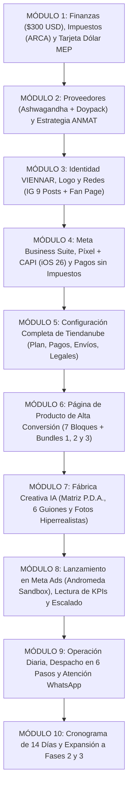
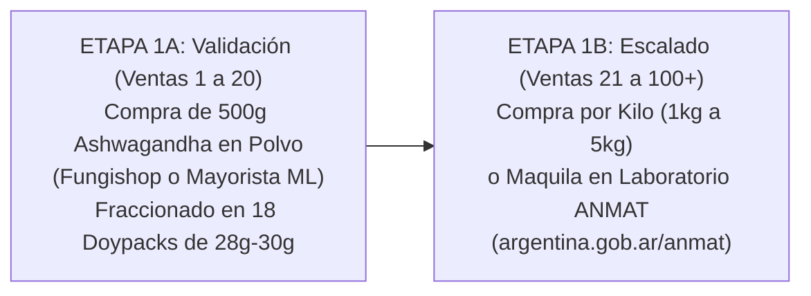

# 🏛️ PLAN MAESTRO PASO A PASO: LANZAMIENTO Y ESCALADO DE VIENNAR (ARGENTINA 2026)

> [!IMPORTANT]
> **Propósito de este Documento:** Este es el **Manual Operativo Único (SOP)** de tu marca **VIENNAR**. Está diseñado para darte **claridad mental absoluta y orden de ejecución**, cruzando y razonando **5 fuentes de información reales**:
> 1. 🛒 **Cuaderno `Juan Gimenez` (50 fuentes):** Selección de producto *winner* invariante, laboratorios ANMAT, estructura de oferta con alto AOV, generación de activos hiperrealistas con IA (Claude + ChatGPT + Gemini Nano Banana) y campañas de renovación creativa.
> 2. 📦 **Cuaderno `Ecommerce curso 34 fuentes` (34 fuentes):** Calculadora de costos de Argentina, regla de testeo de bajo capital sin clavar stock, anatomía de Tiendanube (5 páginas legales + 7 bloques de producto), edición vertical 9:16 y gestión post-venta en 6 pasos.
> 3. 🎨 **Cuaderno `Meta ADS` (19 fuentes — Actualización Algoritmo Andromeda y GEM 2025/2026):** Infraestructura de datos para iOS 26 (Píxel + API de Conversiones con `EMQ > 7`), *Entity IDs*, *Branch-Cutting* (`Similitud Creativa < 40%`), Matriz **P.D.A.** (*Persona × Deseo × Conciencia*), *Sandbox ABO* vs. *CBO/ASC* y métrica de fatiga `CPMr`.
> 4. 🧘🏽‍♀️ **Cuaderno `Sistema Nervioso Regulado` (2 fuentes):** Psicología profunda, síntomas reales (hipervigilancia, paradoja del sueño, eje intestino-cerebro, cortisol alto) y herramientas somáticas que usaremos en nuestros ángulos de venta y en la Guía Digital de regalo.
> 5. 🇦🇷 **Investigación de Mercado en Vivo (Argentina Noviembre 2026):** Precios mayoristas actuales de Ashwagandha (*Fungishop* y granel), bolsas Doypack negro mate, planes actuales de Tiendanube/Pago Nube, tarifas de Envío Nube (Correo Argentino Paq.ar / Andreani), Monotributo ARCA y pago de Meta Ads con Dólar MEP sin impuestos.

---

## 🗺️ Mapa de Arquitectura y Flujo de Ejecución

---

## MÓDULO 1: Claridad Financiera (\$300 USD), Impuestos (ARCA) y Cuentas de Pago

### 1.1. Razonamiento de Asignación de Capital (\$300 USD = \$405.000 ARS a \$1.350/USD)
* **¿Qué dicen tus fuentes?** Tanto *Juan Giménez* como el *Curso de 34 fuentes* advierten que el error #1 del principiante con poco capital es **gastar el 80% de su plata en mercadería y quedarse sin oxígeno para pautar en Meta Ads**.
* **Nuestro Razonamiento:** Tus **\$300 USD (\$405.000 ARS)** tienen que dividirse de forma que **al menos el 45%–50% quede líquido para publicidad**, y el resto financie un **Lote Mínimo de Validación (17 a 20 unidades)** capaz de cubrir las primeras **10 a 15 ventas**. Con el cobro de esas primeras 10 ventas (que ingresan en el acto a Pago Nube / Mercado Pago), reponés stock sin poner un peso extra de tu bolsillo.

| Rubro de Inversión Inicial | Monto Estimado (ARS) | Monto (USD) | % del Capital | Razonamiento Estratégico |
| :--- | :---: | :---: | :---: | :--- |
| **1. Lote Mínimo Materia Prima (500g Ashwagandha)** | \$120.000 – \$160.000 | ~\$89 – \$118 | **35%** | Rinde **17 a 20 bolsas de 25g–30g** (1 mes de uso c/u). Alcanza de sobra para validar las primeras 10–15 órdenes. |
| **2. Packaging (100 Doypacks + Etiquetas + Gramera)** | \$42.000 – \$55.000 | ~\$31 – \$40 | **12%** | 100 bolsas Doypack 10x15cm o 11x16cm Negro Mate (~\$22.000) + 100 etiquetas vinilo impermeables (~\$12.000) + Balanza gramera digital (~\$8.000) + Sobres e-commerce (~\$5.000). |
| **3. Plataforma Web y Herramientas IA** | **\$0 ARS** | **\$0 USD** | **0%** | Arrancamos con **Plan Inicial Gratis de Tiendanube** + Canva Gratis + CapCut Gratis + Antigravity (yo) para guiones, textos e imágenes IA. |
| **4. Presupuesto de Pauta en Meta Ads (Oxígeno)** | **\$190.000 – \$240.000** | **~\$142 – \$177** | **53%** | Reservado 100% para las campañas de testeo y optimización a **\$4 – \$5 USD/día** (te da **más de 30 a 35 días enteros de oxígeno publicitario** sin presión). |
| **TOTAL CAPITAL INICIAL** | **\$405.000 ARS** | **\$300 USD** | **100%** | **Riesgo controlado al milímetro y liquidez garantizada.** |

> [!TIP]
> **¿Cómo cerrás el Doypack en los primeros 15 pedidos sin gastar \$35.000 en una selladora térmica?**
> Las bolsas Doypack ya traen **cierre Zipper hermético de fábrica**, y para el precinto superior de seguridad podés sellar el borde superior de las primeras 15 bolsitas usando una **planchita de pelo o el borde de una plancha doméstica tibia interponiendo papel manteca** durante 2 segundos. Recién cuando superes las 20 ventas comprás la selladora manual de impulso de 20cm (\$28.000 ARS) con las ganancias.

---

### 1.2. Cómo Pagar Meta Ads en Argentina Sin Regalarle 60% de Impuestos al Banco
* **El Problema:** Si ponés una tarjeta de crédito o débito bancaria común en pesos para pagar una cuenta de Meta Ads en dólares, el banco te cobra el "Dólar Tarjeta" (con recargos e impuestos que encarecen tu publicidad entre un 30% y un 60%).
* **Las 2 Soluciones Validadas en Argentina (2026):**

#### Opción A (La más recomendada por estabilidad): Pagar en USD con Dólar MEP / Dólar Digital (0% Impuestos Extra)
1. Abrite una cuenta gratuita en **Brubank** (con caja de ahorro en USD habilitada), **Prex**, **DolarApp (ARQ)** o **Takenos**.
2. Comprá **Dólar MEP** o fondeá USD digitales al tipo de cambio libre (~\$1.350 ARS).
3. En tu tarjeta de débito de Brubank / DolarApp / Prex, configurá que los **consumos internacionales se debiten directamente de tu saldo en Dólares (USD)**.
4. Cuando Meta Ads te cobra \$10 USD, se debitan exactamente **\$10 USD limpios** de tu cuenta en dólares, **sin percepciones ni impuestos al peso**.

#### Opción B (Alternativa Simple en Pesos): Cuenta Publicitaria en ARS con Mercado Pago Prepago
1. Al crear la Cuenta Publicitaria en Meta Business Suite, elegís moneda **Peso Argentino (ARS)** y país **Argentina**.
2. En *Configuración de Pagos*, elegís **Medios de pago locales (Mercado Pago / Rapipago prepago)**.
3. Cargás saldo de forma prepaga desde tu Mercado Pago antes de prender la campaña. *(Consejo: Cargá de a \$25.000 – \$40.000 ARS a medida que vas testeando; nunca cargues \$200.000 ARS de golpe en una cuenta prepaga nueva por si Meta pide verificación de identidad).*

---

### 1.3. Situación Fiscal en Argentina: ARCA (ex-AFIP), Monotributo y Cuota Simple
* **¿Qué dicen ambos cuadernos (`Juan Gimenez` y `Curso 34 fuentes`)?**
  * Podés armar la tienda hoy mismo sin ser Monotributista, pero **hacerte Monotributista (Categoría A, la más baja)** apenas arrancás tiene **2 ventajas enormes**:
    1. **Activás las 3 Cuotas Sin Interés (Cuota Simple):** En Argentina, el cartel de *"3 cuotas sin interés de \$9.633"* duplica la tasa de conversión frente a cobrar solo en 1 pago. Para que Pago Nube o Mercado Pago te den la tasa bonificada de **Cuota Simple (~6,20% + IVA)** en vez de cobrarte un 18%–25% de financiación bancaria común, te piden tener CUIT con Monotributo activo.
    2. **Evitás las Retenciones Punitivas (SIRTAC / SIRCUPA):** Cuando vendés más de 10–15 pedidos sin estar inscripto en ARCA/IIBB, Mercado Pago y Pago Nube te catalogan como *"Sujeto No Categorizado"* y te retienen automáticamente entre un **10% y un 25%** de cada venta.
* **Regla de Ejecución para Vos:**
  * Si ya tenés **Monotributo activo**, vinculás tu CUIT directo en Pago Nube / Mercado Pago.
  * Si **todavía no sos Monotributista**, no frenes el armado de la tienda por eso: podés lanzar el testeo inicial de las primeras 5–10 ventas cobrando con **Pago Nube / Mercado Pago** (y ofreciendo 15% OFF por Transferencia Bancaria) mientras tramitás el alta online en ARCA en 15 minutos con tu Clave Fiscal Nivel 3.

---

## MÓDULO 2: Proveedores, Packaging, Fraccionamiento y Ruta ANMAT

### 2.1. Estrategia de Stock en 2 Etapas (Cero Riesgo -> Marca Escalable)

#### Etapa 1A: Compra del Lote de Validación (Hoy)
* **Opción 1 (Proveedor Especializado Verificado):** **Fungishop** (Olivos, GBA — envían a todo el país).
  * **WhatsApp:** `+54 9 11 3907-7645` | **Email:** `contacto@fungishop.com.ar` | **Web:** `fungishop.com.ar`
  * **Producto:** Bolsa de **500g de Ashwagandha Molida / Extracto Seco**.
* **Opción 2 (Mayoristas de Granel en Mercado Libre con Envío Full 24/48hs):**
  * Buscá en Mercado Libre: *"Ashwagandha en polvo 500g"* o *"Ashwagandha extracto seco 1kg"*.
  * **Truco del `Curso 34 fuentes`:** Mirá el nombre del vendedor en Mercado Libre (ej. distribuidoras de suplementos naturales / químicas alimentarias con calificación >4.7 estrellas), buscalo en Google/Instagram y escribile por WhatsApp directo para pedirle precio mayorista sin la comisión del 16% de Mercado Libre.

#### Etapa 1B: El Método de Juan Giménez para Escalar con Laboratorios de ANMAT
Una vez que validemos que **VIENNAR — Ansiedad y Estrés** mete 5 a 10 ventas por día:
1. Entrás a `https://www.argentina.gob.ar/anmat` -> sección **Listados de Establecimientos / Suplementos Dietarios y Alimentos**.
2. Buscás la columna **Elaborador / Fraccionador** (no el titular de la marca, sino la fábrica que les hace el producto).
3. Les escribís por WhatsApp pidiendo **fraccionamiento a façón (marca blanca)** o compra de cuñete de 5kg con certificado de análisis (COA) y registro vigente. Así bajás el costo por sobre de **\$6.000 ARS a menos de \$2.500 ARS** y tenés respaldo documental total.

---

### 2.2. Especificaciones Exactas del Packaging de VIENNAR (Fase 1)
Para que un sobre de **30 gramos de polvo** parezca un producto europeo de **\$28.900 ARS** (alto valor percibido, Regla #1 de Juan Giménez):
* **Envase:** Bolsa **Doypack (Stand-Up Pouch) con cierre Zipper** en acabado **Negro Mate Opaco (Alta Barrera tricapa BOPP mate + PET metalizado interno + PE)**.
  * *¿Por qué Negro Mate tricapa y no papel Kraft común?* Porque el interior metalizado protege la Ashwagandha de la humedad (no se apelmaza), no se mancha con la yerba ni el agua en la cocina/escritorio del cliente, y transmite estética clínica/premium.
* **Medida exacta a comprar:** **10 x 15 cm** o **11 x 16 cm** (capacidad 50g–70g, ideal para 30g de raíz en polvo sin que el sobre quede gigante y vacío).
  * *Dónde comprar x100 unidades hoy:* En Mercado Libre buscando `"Bolsas doypack 10x15 negro mate x100"` o `"Bolsas doypack 11x16 negro mate zipper x100"` (Papelera Damián, Naguara, ABC Empaques).
* **Etiqueta Frontal y Dorso:**
  * Medida: **7 x 9 cm** o **8 x 10 cm** impresa en **Vinilo Autoadhesivo o OPP Blanco Mate/Brillante resistente al agua** (cualquier gráfica digital de tu ciudad te imprime una plancha de 50 o 100 etiquetas ya troqueladas en 24hs por ~\$12.000 ARS).
* **Ración y Duración:**
  * **Contenido Neto:** **30 gramos** (30 porciones de **1 gramo** = 1/3 de cucharadita de té colmada por cada termo/mate diario). Dura **1 mes entero (30 días)**.

---

## MÓDULO 3: Identidad Visual, Redes Sociales (IG + FB) y Confianza

### 3.1. Identidad de Marca: Por qué "VIENNAR" Cumple Todas las Reglas
* Es corto, fácil de pronunciar, suena a laboratorio de bienestar nórdico/europeo y **no te encierra en un solo ingrediente**: hoy lanzás **VIENNAR — Ansiedad y Estrés**, en unas semanas sumás **VIENNAR — Enfoque y Memoria**, luego **VIENNAR — Energía y Vitalidad**, y el día de mañana podés vender magnesio, creatina, termos o infusores bajo el mismo paraguas.
* **Paleta de Colores Oficial de VIENNAR (Confirmada y Fijada en Memoria):**
  * **Fondo Principal Web y Tipografía del Logo:** Blanco Crema Suave (`#FAF8F5`) — limpio, cálido y descansado para la vista.
  * **Color Primario (Fondo del Logo, Tipografía Web, Botones de Compra y Encabezados):** Negro Mate Profundo (`#0D0D0D`).
  * **Color de Acento (Fase 1 - Ansiedad y Estrés en el sobre y detalles):** Beige Arena Cálido (`#D8C3A5`).

---

### 3.2. Configuración de Instagram (`@viennar.ar` / `@somosviennar`) y Fan Page de Facebook
* **Síntesis de tus Cuadernos:** El *Curso de 34 fuentes* explica que el 80% de las ventas por impulso van del anuncio directo a la web, pero *Juan Giménez* advierte que dejar el Instagram vacío te hace perder ventas de los compradores que entran a verificar si la tienda existe.
* **La Regla del "Feed de 9 Publicaciones + 4 Historias Destacadas" (Te toma 1 hora y queda listo para siempre):**
  1. **Biografía de Instagram Lista para Copiar:**
     > **VIENNAR® | Bienestar & Adaptógenos para tu Mate**
     > 🧉 Transformá tu mate diario en tu cable a tierra.
     > 🌿 Polvos 100% puros sin sabor que regulan tu estrés y foco.
     > 💳 3 Cuotas Sin Interés | 🚚 Envíos a todo el país.
     > 👇 Conseguí tu Pack Anti-Estrés + Guía Gratis acá:
     > `[Link a tu Tiendanube]`
  2. **4 Historias Destacadas (Highlights):**
     * `🧉 ¿Cómo se usa?` (3 historias mostrando que se pone 1/3 de cucharadita arriba de la montañita de yerba y no cambia el sabor).
     * `⭐ Clientes` (Capturas de WhatsApp y fotos de clientes recibiendo su sobre junto al mate).
     * `🚚 Envíos` (Explicando que despachamos a todo el país por Correo Argentino / Andreani con código de seguimiento).
     * `🧠 Ciencia` (Explicando qué es la Ashwagandha y cómo baja el cortisol).
  3. **Los 9 Posts del Feed (Cuadrícula 3x3):** En el archivo complementario [`KIT_EJECUCION_VIENNAR_COPY_Y_GUIONES.md`](file:///c:/Users/santi/Proyectos%20IA/Ecommerce/KIT_EJECUCION_VIENNAR_COPY_Y_GUIONES.md) te dejé los 9 textos y prompts listos para publicar antes de prender el primer anuncio.

---

## MÓDULO 4: Arquitectura de Meta Business Suite, Píxel + CAPI (iOS 26) Anti-Baneos

> [!CAUTION]
> **Regla Anti-Bloqueos de Meta:** Nunca crees un perfil personal de Facebook falso hoy para abrir un Business Manager a los 5 minutos, porque el sistema automatizado de Meta te lo bloquea en el acto. Usá siempre **tu perfil personal real de Facebook** (que tiene años de antigüedad) como administrador del Portfolio Comercial, activale la **Autenticación en Dos Pasos (2FA)** y creá adentro la Fan Page de **VIENNAR**.

### 4.1. Paso a Paso para Crear tu Infraestructura en Meta (`business.facebook.com`)
1. Entrá a `business.facebook.com/overview` desde tu Facebook personal real y creá un **Portfolio Comercial (Business Manager)** llamado **`VIENNAR Oficial`**.
2. Dentro de *Configuración del Negocio*:
   * **Cuentas > Páginas:** Creá o agregá la Página de Facebook **`VIENNAR`**.
   * **Cuentas > Cuentas de Instagram:** Conectá el Instagram profesional de **`VIENNAR`**.
   * **Cuentas > Cuentas Publicitarias:** Hacé clic en *Crear una nueva cuenta publicitaria*:
     * Nombre: `VIENNAR Ads 01`.
     * Zona horaria: `(GMT-03:00) America/Argentina/Buenos_Aires`.
     * Divisa: **USD (Dólares)** si vas a pagar con tarjeta en USD (Brubank/Prex/DolarApp con Dólar MEP), o **ARS (Peso Argentino)** si vas a usar Mercado Pago Prepago local.
   * **Orígenes de Datos > Conjuntos de Datos (Píxeles):** Hacé clic en *Agregar*, poné `Pixel VIENNAR Web` y copiá el **ID del Conjunto de Datos (Píxel)**.

---

### 4.2. Conexión Nativa Píxel + API de Conversiones (CAPI) en Tiendanube (Regla iOS 26 del Cuaderno `Meta ADS`)
* **Por qué es obligatorio según tu cuaderno `Meta ADS`:** Desde **iOS 26** (septiembre 2025/2026), los teléfonos limpian el parámetro `fbclid` y bloquean el rastreo del navegador. Si solo usás el Píxel viejo, **Andromeda pierde hasta el 35% de las señales de compra**. Necesitás **Píxel + API de Conversiones (CAPI)** corriendo en paralelo con **Deduplicación automática** y un puntaje **EMQ (Event Match Quality) mayor a 7**.
* **Cómo se activa en Tiendanube en 3 minutos (sin programar nada):**
  1. En tu panel de Tiendanube, andá a **Canales de Venta > Facebook / Meta** (o *Configuración > Códigos Externos > Facebook Pixel*).
  2. Hacé clic en **Conectar cuenta de Meta** e iniciá sesión con tu Facebook.
  3. Seleccioná tu Portfolio Comercial (`VIENNAR Oficial`), tu Fan Page, tu Cuenta Publicitaria y tu `Pixel VIENNAR Web`.
  4. Activá la opción **"Coincidencias Avanzadas Automáticas"** (*Automatic Advanced Matching*) en el Administrador de Eventos de Meta (marcando Email, Teléfono, Nombre, Apellido, Ciudad y Código Postal).
  5. **Listo:** Tiendanube activa automáticamente la **API de Conversiones (CAPI)** desde su servidor con deduplicación nativa por `event_id` y `fbp`.

---

## MÓDULO 5: Configuración Paso a Paso de Tiendanube (Rentabilidad y Conversión)

### 5.1. ¿Con qué Plan y Pasarela de Pago Arrancamos? (Razonamiento con Números)
Revisando los planes vigentes de Tiendanube en Argentina hoy:
* **Estrategia Ganadora de Arranque (Día 1 al 30):**
  * **Plan:** **Plan Inicial (\$0 ARS / mes)** o los 7/30 días bonificados del **Plan Esencial**.
  * **Pasarela Principal:** **Pago Nube** (te bonifica al **0% el costo por transacción de Tiendanube**, ahorrándote el 2% de comisión de plataforma en cada venta) + **Transferencia Bancaria / Alias con 10% o 15% de descuento extra** (en transferencia tu comisión es 0% y recibís la plata en el acto en tu banco/billetera).
  * **Cuotas:** Activás **3 cuotas sin interés** mediante **Cuota Simple** (tasa ~6,20% + IVA).

---

### 5.2. Configuración de Envíos (`Envío Nube`: Correo Argentino Paq.ar + Andreani)
1. En Tiendanube andá a **Configuración > Formas de entrega** y activá **Envío Nube** (Correo Argentino y Andreani) porque te da tarifas corporativas con descuento y genera las etiquetas en 1 clic.
2. **Truco Crítico de Peso y Dimensiones:** Cuando cargues el producto **VIENNAR — Ansiedad y Estrés**, en la sección *Peso y Dimensiones* poné:
   * **Peso:** `0.06 kg` (60 gramos, y en los packs x2 o x3 poné `0.15 kg`).
   * **Profundidad:** `15 cm` | **Ancho:** `11 cm` | **Alto:** `4 cm`.
   * *Por qué:* Así el cotizador de Correo Argentino y Andreani toma siempre el **escalón tarifario más barato de todos (menos de 0,5 kg / 1 kg)**.
3. **Configuración de la Regla de Envío Gratis (Como enseña el `Curso 34 fuentes`):**
   * En las opciones de entrega, configurá **Envío Gratis en compras superiores a \$25.000 ARS** (o incluido directamente en el **Pack x2** y **Pack x3** para obligar psicológicamente al cliente a llevar 2 unidades en vez de 1).

---

### 5.3. Estructura de Precios de Testeo y Variantes de Cantidad (Bundles 1, 2 y 3)
Siguiendo nuestra [`calculadora_costos_fungishop.md`](file:///c:/Users/santi/Proyectos%20IA/Ecommerce/calculadora_costos_fungishop.md) y la regla de tus dos cuadernos (*arrancar con margen de 12%–15% en 1 unidad e impulsar el ticket promedio con Packs x2 y x3 + Regalo Digital*):

| Variante en Tiendanube (Nombre exacto del desplegable) | Precio Tachado (Comparación) | Precio Promocional de Venta | Precio por Sobre | Qué incluye la Oferta | Tu Ganancia Neta Estimada (Descontando Producto, Envío, Comisiones y CPA \$6.750) |
| :--- | :---: | :---: | :---: | :---: | :---: |
| **Opción 1: Lleva 1 Sobre (30 Mates - 1 Mes)** | \$34.900 | **\$26.900 ARS** *(o \$21.900 + envío)* | \$26.900 | 1x Sobre VIENNAR Ansiedad y Estrés (30g) + Guía Digital Anti-Cortisol Gratis | **~\$4.500 – \$6.200 ARS** *(Margen testeo ~17%–22%)* |
| **🔥 Opción 2: Lleva 2 Sobres (20% OFF + Envío Gratis) [MÁS ELEGIDO]** | \$69.800 | **\$43.900 ARS** | \$21.950 c/u | 2x Sobres VIENNAR (60 días o para compartir) + **Envío Gratis** + Guía Digital Gratis | **~\$13.500 – \$16.800 ARS** *(Margen neto ~32%–38%)* |
| **👑 Opción 3: Lleva 3 Sobres (35% OFF + Envío Gratis Prioritario)** | \$104.700 | **\$56.900 ARS** | \$18.966 c/u | 3x Sobres VIENNAR (Ciclo Completo 90 días) + **Envío Gratis** + Guía Digital Gratis | **~\$21.000 – \$25.500 ARS** *(Margen neto ~37%–44%)* |

> [!NOTE]
> **Mirá la magia matemática de los Packs:** Cuando un cliente elige el **Pack x2 (\$43.900 ARS)** o el **Pack x3 (\$56.900 ARS)**, vos pagás **1 solo envío (\$6.500 ARS)** y **1 solo CPA en Meta Ads (\$6.750 ARS)**. Eso hace que tu **CPA Break-Even suba de ~\$12.000 ARS a más de \$20.000–\$28.000 ARS**, dándote una espalda gigante en las subastas de Meta Ads.

---

### 5.4. Las 5 Páginas Legales y las 3 Apps Clave en Tiendanube
1. **Las 5 Páginas Legales Obligatorias (Para que Meta Ads no marque tu web como baja calidad):**
   * En *Mi Tiendanube > Páginas*, creás: `Contacto`, `Políticas de Envío`, `Políticas de Devolución y Garantía (30 días)`, `Política de Privacidad` y `Términos y Condiciones`. *(Tenés los 5 textos redactados listos para copiar y pegar en [`KIT_EJECUCION_VIENNAR_COPY_Y_GUIONES.md`](file:///c:/Users/santi/Proyectos%20IA/Ecommerce/KIT_EJECUCION_VIENNAR_COPY_Y_GUIONES.md)).*
2. **Botón Flotante de WhatsApp:**
   * En *Configuración > WhatsApp*, ponés el número de WhatsApp Business de la tienda.
3. **Aplicaciones recomendadas por Juan Giménez:**
   * **Trusty (o reseñas visuales integradas en la descripción):** Para mostrar estrellas `★★★★★ (4.9/5)` y fotos caseras realistas de clientes con su mate y el sobre de VIENNAR.
   * **Scalafy:** Para conectar el gasto de Meta Ads con las ventas de Tiendanube y ver tu ganancia neta real por día.

---

## MÓDULO 6: Diseño de la Página de Producto de Alta Conversión (Los 7 Bloques)

Combinando la plantilla del **`Curso 34 fuentes`**, la regla de **"Bajo Tiempo de Fricción y Dopamina Visual" de `Juan Gimenez`** y el lenguaje psicológico de tu cuaderno **`Sistema Nervioso Regulado`**, nuestra página de producto no es un "choclo de texto técnico sobre la planta *Withania somnifera*", sino un embudo visual de 7 bloques rápidos:

1. **Bloque 1 (Encabezado de Dolor / Identificación Inmediata):**
   * *"🧠 ¿Vivís acelerado, cualquier ruido te irrita y a la noche tu cabeza no se apaga aunque estés muerto de cansancio? 🧉"*
2. **Bloque 2 (Demostración Visual / GIF de 3 Segundos):**
   * Imagen hiperrealista y GIF mostrando cómo se agrega 1/3 de cucharadita de **VIENNAR — Ansiedad y Estrés** sobre la montañita de yerba sin cambiar el sabor del mate.
3. **Bloque 3 (Presentación de la Solución en 3 Renglones):**
   * Explicación directa de cómo la **Ashwagandha Pura VIENNAR** regula tus picos de cortisol y saca a tu sistema nervioso del modo "alerta/peligro" usando el hábito que ya tenés todas las mañanas.
4. **Bloque 4 (Los 5 Beneficios de Placer y Alivio de Dolor — Basados en `Sistema Nervioso Regulado`):**
   * 🌿 **Bajá dos cambios reales:** Apagá la hipervigilancia y la irritación ante el estrés del trabajo o los parciales.
   * 😴 **Recuperá el sueño profundo:** Evitá acostarte agotado y quedarte dando vueltas porque "se te fue el sueño".
   * 🧘‍♂️ **Aliviá el nudo en el estómago (Eje Intestino-Cerebro):** Menos tensión abdominal, hinchazón y pesadez nerviosa.
   * 🧉 **100% Neutro en tu Mate:** Se funde con tu yerba favorita sin alterar el gusto ni dar sueño durante el día.
   * 🎁 **Incluye GRATIS la Guía Digital de 7 Días:** Ejercicios somáticos de 2 minutos para resetear tu sistema nervioso.
5. **Bloque 5 (Prueba Social Anti-Objeciones):**
   * 3 reseñas con fotos tomadas desde celular en escritorios/cocinas argentinas reales que responden: *"¿Cambia el gusto de la yerba?"*, *"¿Cuándo se empieza a notar?"* y *"¿Llegó rápido el envío?"*.
6. **Bloque 6 (Modo de Uso en 3 Pasos + Ficha Simple):**
   * 1) Armá tu mate como siempre -> 2) Sumá 1/3 de cucharadita (1g) en la montañita o en el agua -> 3) Cebá y sentí la calma enfocada.
7. **Bloque 7 (Garantía de 30 Días + Preguntas Frecuentes + Badges de Confianza):**
   * 3 cuotas sin interés, envío con seguimiento por Correo Argentino/Andreani y garantía de satisfacción.

*(Todo el código/texto exacto de estos 7 bloques está listo para copiar y pegar en [`KIT_EJECUCION_VIENNAR_COPY_Y_GUIONES.md`](file:///c:/Users/santi/Proyectos%20IA/Ecommerce/KIT_EJECUCION_VIENNAR_COPY_Y_GUIONES.md)).*

---

## MÓDULO 7: Estrategia de Creativos e IA bajo el Algoritmo Andromeda (Matriz P.D.A.)

### 7.1. Por qué fallan los anuncios viejos y cómo ganamos con Andromeda + Juan Giménez
* **Lo que descubrimos en tu cuaderno `Meta ADS` (19 fuentes):**
  1. **El Creativo ES la Segmentación:** Andromeda usa visión por computadora y el modelo **GEM** para leer qué pasa en los primeros 3 segundos de tu video, qué dice el texto y qué problema menciona, y se lo muestra exactamente a las personas que sufren ese problema.
  2. **La Trampa del *Entity ID* y el *Branch-Cutting*:** Si subís 6 anuncios que dicen casi lo mismo (solo cambiando una palabra o el color del título), Andromeda detecta una **Similitud Creativa > 60%**, les asigna el mismo `Entity ID` y **suprime 5 de los 6 anuncios**.
  3. **La Solución (Matriz P.D.A. + Regla 1-1-6 de Juan Giménez):** Nuestros **6 anuncios iniciales** tienen que tener **menos de 40% de similitud creativa entre sí**, cruzando **3 Ángulos Psicológicos Distintos × 2 Formatos Visuales Distintos (Video 9:16 CapCut + Imagen Estática Hiperrealista IA / Carrusel)**.

---

### 7.2. La Matriz P.D.A. (*Persona × Deseo × Conciencia*) de VIENNAR — Fase 1

| Concepto / Entity ID | Persona (Avatar) | Deseo / Dolor Profundo (`Sistema Nervioso Regulado`) | Nivel de Conciencia | Formato 1 (Video 9:16 CapCut + Voz IA) | Formato 2 (Estático Hiperrealista IA) |
| :--- | :--- | :--- | :--- | :--- | :--- |
| **ÁNGULO 1: "La Paradoja del Cansancio y la Mente Acelerada"** | Joven / Profesional / Estudiante (20–45 años) saturado en noviembre/diciembre | Estar muerto de cansancio pero acostarse y perder el sueño por sobrepensar; vivir irritable por cualquier ruido | *Problem-Aware* (Consciente del dolor, no conoce que puede usar su mate) | **Anuncio 1A (Video):** Hook visual sirviendo el polvo en el mate + historia de *"Estar cansadísimo pero acostarte y que se te vaya el sueño"* | **Anuncio 1B (Estático IA):** Comparativa visual *"Tu cabeza sin regular (Cortisol alto)" vs "Tu cabeza con 1 cucharadita en el mate"* |
| **ÁNGULO 2: "El Nudo en el Estómago y el Eje Intestino-Cerebro"** | Personas que somatizan los nervios en la panza, mandíbula apretada (bruxismo) y pecho cerrado | Bajar un cambio físico real, soltar la tensión abdominal y los hombros sin tomar pastillas químicas | *Unaware / Problem-Aware* (Descubre por qué el estrés le inflama la panza) | **Anuncio 2A (Video Educativo):** Explicación visual de cómo el modo "alerta" frena tu digestión y te tensa, y cómo la Ashwagandha en el mate apaga la alarma | **Anuncio 2B (Estático IA):** Infografía de producto en mesa argentina con flechas a los 4 síntomas de cortisol alto |
| **ÁNGULO 3: "El Ritual del Mate Anti-Cortisol (Oferta + Prueba Social)"** | Tomadores diarios de mate que ya escucharon hablar de adaptógenos / Ashwagandha pero odian las cápsulas o goteros feos | Practicidad total: no olvidarse nunca de tomarlo porque ya está adentro de su mate de cada mañana | *Solution-Aware* (Busca la forma más rica, fácil y económica de tomarlo) | **Anuncio 3A (Video Demostrativo / Unboxing):** Mostrando el paquete negro mate de VIENNAR, que no cambia el sabor de la yerba y el regalo de la Guía de 7 Días | **Anuncio 3B (Estático Reseña Celular):** Foto estilo historia de Instagram / WhatsApp junto al termo y mate con reseña real de 5 estrellas |

*(Los 6 guiones completos palabra por palabra + los prompts de generación de imágenes están listos en [`KIT_EJECUCION_VIENNAR_COPY_Y_GUIONES.md`](file:///c:/Users/santi/Proyectos%20IA/Ecommerce/KIT_EJECUCION_VIENNAR_COPY_Y_GUIONES.md)).*

---

## MÓDULO 8: Lanzamiento, Lectura de Métricas y Escalado en Meta Ads

### 8.1. Reconciliando el Presupuesto de Testeo entre tus 3 Cuadernos para Cuidar tus \$300 USD
* **¿Qué dice cada fuente?**
  * *Juan Giménez:* Campaña CBO 1-1-6 con \$35 a \$60 USD/día (pensado para cuando ya tenés más capital o querés escalar rápido).
  * *Cuaderno `Meta ADS` (Andromeda):* En fase de testeo ("Sandbox"), recomienda usar **ABO** para evitar el *Hot Ad Bias* (donde CBO le da el 90% de la plata a un solo anuncio en las primeras 3 horas y no deja probar los otros), con segmentación **100% Abierta (Broad)**.
  * *Curso 34 fuentes:* Testeo con **\$10 USD/día** para cuidar un capital inicial de \$300 USD.
* **Nuestra Configuración Exacta y Razonada para VIENNAR (El "Micro-Sandbox Protegido" de \$4 a \$5 USD/día):**
  * **Por qué \$4 a \$5 USD/día (~\$5.400 a \$6.750 ARS/día) es ideal para tu tranquilidad mental:** Con tus ~\$150–\$170 USD reservados para publicidad, gastar \$4,50 o \$5 USD por día te da **más de 30 días completos de pauta**. No tenés ninguna presión ni ansiedad si el Día 1 estás rindiendo en la facultad, y le das tiempo de sobra al Píxel para aprender sin quemar plata.
  * **Regla Técnica Clave cuando pautás \$4 a \$5 USD/día:** Como el presupuesto diario es de \$4,50 – \$5 USD en total, **no podés dividirlo en 5 conjuntos distintos** (porque Meta pide mínimo ~\$1 a \$1,50 USD por conjunto). Entonces tenés dos formas súper limpias de armarlo:
    * **Opción A (3 Conjuntos ABO de \$1,50 USD/día cada uno = \$4,50 USD/día total):**
      * Conjunto 1 (\$1,50 USD/día - Broad Argentina 21–55+): Ángulo 1 (Video 1A + Estático 1B).
      * Conjunto 2 (\$1,50 USD/día - Broad Argentina 21–55+): Ángulo 2 (Video 2A + Estático 2B).
      * Conjunto 3 (\$1,50 USD/día - Broad Argentina 21–55+): Ángulo 3 (Video 3A + Estático 3B).
    * **Opción B (1 Sola Campaña CBO 1-1-4 o 1-1-6 con \$4,50 a \$5 USD/día total):**
      * 1 Campaña CBO (\$5 USD/día) -> **1 solo Conjunto de Anuncios Abierto (Broad)** -> **4 a 6 anuncios adentro** (dejando que Andromeda elija cuáles mostrar al menor costo).

---

### 8.2. Cómo Configurar tus Columnas en el Administrador de Anuncios y Leer el Embudo
Antes de prender la campaña, en el Administrador de Anuncios vas a *Columnas > Personalizar columnas* y guardás la vista **`VIENNAR Control`** con este orden exacto:

| Etapa del Embudo | Métrica a Mirar | Valor Objetivo (Semáforo Verde 🟢) | Qué hacer si da Rojo 🔴 (Diagnóstico Razonado) |
| :--- | :--- | :---: | :--- |
| **1. Salud de Subasta y Fatiga** | **CPM** y **CPMr** *(Gasto / Alcance × 1.000)* | **CPM:** \$1,50 – \$4,00 USD **CPMr:** `< $20 USD` | Si el `CPMr` se dispara de golpe, el anuncio saturó su micro-audiencia -> Rotar creativo. |
| **2. Poder del Gancho (Hook 3 seg)** | **CTR (Porcentaje de clics en el enlace)** | **Mayor a 2,0%** *(Ideal > 2,5%)* | Si el CTR es `< 1,5%`, la gente sigue de largo -> Cambiar los primeros 3 segundos (Hook visual y primera frase). |
| **3. Tráfico Barato a la Tienda** | **CPC (Costo por clic en el enlace)** | **Menor a \$0,20 – \$0,35 USD** | Si el CPC pasa de \$0,45 USD, el anuncio no genera suficiente curiosidad -> Pausar ese creativo tras 48hs. |
| **4. Interés en la Página (Landing)** | **Añadidos al Carrito (ATC)** sobre Visitas a la Página | **~8% de las visitas efectivas** | Si tenés muchos clics baratos pero `< 3%` agrega al carrito -> Revisar que la página cargue rápido y que los Bundles (1, 2 y 3) se vean claros arriba. |
| **5. Intención Real de Pago** | **Pagos Iniciados (`Initiate Checkout`)** | **~3% de las visitas** *(Costo por IC: \$1 a \$2 USD)* | Debe haber **1 venta cada 3 o 4 Pagos Iniciados**. Si tenés 10 Pagos Iniciados y 0 ventas -> Revisar que Pago Nube/Mercado Pago y el costo de envío en el checkout no tengan errores. |
| **6. Rentabilidad Final** | **CPA Real** vs. **CPA Break-Even** y **ROAS / aMER** | **CPA Real < \$6.750 ARS (\$5 USD)** *(Siempre debajo del Break-Even)* | Si acumulás **5 ventas** por debajo del CPA Objetivo/Break-Even -> **¡Producto y Ángulo Validados! Pasamos a Escalar.** |

---

### 8.3. Las 3 Reglas de Oro de Operación en Meta Ads (Cuadernos `Meta ADS` + `Juan Gimenez`)
1. **Regla del Spam en Comentarios (Truco de Andromeda):**
   * Cuando alguien comente algo negativo o spam en tus anuncios, **NUNCA le respondas con enojo ni lo elimines: OCULTÁ el comentario (*Hide comment*)**.
   * *Por qué (según la fuente #90 de tu cuaderno `Meta ADS`):* Si lo ocultás, nadie más lo ve (protegés tu CTR y conversión), pero **Andromeda lo sigue contando internamente como interacción positiva gratuita**, bajando tu CPM. Y a los comentarios donde preguntan *"Precio"* o *"¿Cambia el sabor del mate?"*, respondeles con amabilidad y el link directo a la tienda.
2. **Regla de Escalado Vertical (Prohibido Duplicar a lo Loco):**
   * Cuando la campaña vende todos los días con buen ROAS/CPA, **no dupliques conjuntos de anuncios idénticos** (porque en Andromeda eso genera *Auction Overlap* y compiten contra sí mismos). En su lugar, **subí el presupuesto de la campaña un 20% cada 48–72 horas** mientras el CPA se mantenga rentable.
3. **Regla de Renovación Creativa Semanal:**
   * En la era Andromeda, los anuncios duran entre **2 y 4 semanas** antes de fatigarse. Una vez por semana (ej. todos los domingos), generamos juntos **3 a 4 anuncios nuevos** (nuevos hooks, estáticos con IA o videos cortos) para mantener vivo el motor de ventas.

---

## MÓDULO 9: Operación Diaria, Despacho en 6 Pasos y Post-Venta Ética

Cada vez que suena la notificación de **"¡Nueva venta en tu Tiendanube!"**, ejecutás este protocolo exacto de 6 pasos del **`Curso de 34 fuentes`** (te lleva menos de 5 minutos por pedido):

1. **Paso 1 (Registro en Base de Datos):** Abrís el archivo [`control_pedidos_viennar.csv`](file:///c:/Users/santi/Proyectos%20IA/Ecommerce/control_pedidos_viennar.csv) (que ya te creé en tu carpeta) y anotás: *Fecha, Nº Pedido, Cliente, WhatsApp, Pack comprado (x1, x2 o x3), Total Cobrado, Neto en Pago Nube/MP, Costo Envío, Costo Producto y Ganancia Neta*.
2. **Paso 2 (Mensaje Inmediato por WhatsApp + Entrega de la Guía Digital):**
   * En las primeras 2 horas desde la compra, le mandás el mensaje de confirmación por WhatsApp (plantilla lista en el Kit) adjuntándole ya mismo su **Guía Digital de Regalo en PDF**.
   * *Por qué esto es brillante:* El cliente recibe valor instantáneo en su celular a los 10 minutos de haber pagado, elimina el 100% del miedo a "si la página será real" y queda feliz esperando su paquete.
3. **Paso 3 (Generación de Etiqueta en Envío Nube):**
   * Desde el pedido en Tiendanube, tocás *Generar etiqueta de envío* (Correo Argentino Paq.ar o Andreani), la imprimís (en hoja A4 común con cinta adhesiva transparente o etiqueta autoadhesiva).
4. **Paso 4 (Empaquetado Limpio y Rápido):**
   * Ponés el/los Doypacks de **VIENNAR — Ansiedad y Estrés** dentro de un sobre impermeable de e-commerce negro (costo ~\$150 ARS c/u), pegás la etiqueta afuera y pintás la celda del pedido en **Amarillo (Preparado)** en tu planilla.
5. **Paso 5 (Despacho en Sucursal de Correo Argentino — Cómo funciona en la vida real en 2 minutos):**
   * **¿Hace falta que haya Andreani en tu ciudad?** ¡Para nada! Con **Correo Argentino** llegás al 100% de las ciudades y pueblos de la Argentina.
   * **¿Cómo funciona cuando vas a la sucursal de Correo Argentino de tu ciudad?**
     1. **Cero trámites ni pagos en ventanilla:** Vos no tenés que llenar formularios a mano ni pagarle en efectivo al empleado del correo. Todo se genera y se abona online desde tu computadora en **Tiendanube (`Envío Nube` / `MiCorreo`)** a tarifa bonificada de e-commerce.
     2. **En tu casa:** Metés el Doypack negro de **VIENNAR** adentro de una bolsita impermeable de e-commerce (esos sobres plásticos negros con tira autoadhesiva que valen ~\$120 ARS), imprimís la etiqueta que te da Tiendanube en una hoja A4 común, la recortás y la pegás bien prolija sobre el paquete con cinta transparente ancha (cuidando de no tapar con cinta opaca el código de barras).
     3. **En el Correo:** Entrás a la sucursal de Correo Argentino de tu ciudad con tus paquetes ya etiquetados, vas al mostrador de *Encomiendas / Paq.ar / E-commerce* y le decís: *"Hola, traigo estos paquetes de Paq.ar / Tiendanube ya pagos con etiqueta"*.
     4. El empleado les pasa el lector óptico al código de barras (*"PIP"*), te sella el talón de comprobante (o te llega el mail automático de admisión) y **en 2 minutos te volvés a tu casa**.
   * **Regla para cuidar tu tiempo de estudio:** Agrupás los paquetes en **2 o 3 días fijos de despacho por semana** (ej. Lunes, Miércoles y Viernes a la mañana) para no ir al correo todos los días y proteger tu foco en la facultad.
6. **Paso 6 (Envío de Código de Seguimiento y Pedido de Reseña):**
   * Le mandás el código de seguimiento por WhatsApp y pintás la fila en **Verde (Despachado)**. A los 5 días de entregado, le pedís una foto del sobre junto a su mate a cambio de un cupón del 15% OFF para su próxima compra (así conseguís fotos reales infinitas para tus anuncios).

---

## MÓDULO 10: Cronograma de Ejecución de 14 Días (Claridad Día por Día)

Para que tu sistema nervioso esté 100% regulado y nunca sientas que "tenés mil cosas juntas por hacer", acá tenés la hoja de ruta dividida en **bloques diarios de 1 a 2 horas**:

| Día | Bloque Único de Enfoque del Día | Tiempo Estimado | Resultado Concreto al Terminar el Día |
| :--- | :--- | :---: | :--- |
| **Día 1** | **Proveedores y Packaging:** Pedir presupuesto/compra de 500g de Ashwagandha (*Fungishop* o ML) + Pack x100 bolsas Doypack Negro Mate 10x15/11x16cm + Gramera digital. | 45 min | Materia prima y envases en camino a tu domicilio. |
| **Día 2** | **Identidad e Impresión de Etiquetas:** Definir diseño final de la etiqueta frontal/dorso de **VIENNAR — Ansiedad y Estrés** y enviarla a gráfica local (50–100 stickers vinilo). | 1 hora | Etiquetas impermeables encargadas. |
| **Día 3** | **Redes Sociales (IG + FB):** Crear cuenta de Instagram `@viennar.ar`, Fan Page de Facebook, foto de perfil (Logo) y subir las 4 Historias Destacadas. | 1 hora | Presencia social creada. |
| **Día 4** | **Grilla de Confianza (9 Posts IG):** Subir los 9 posts iniciales del feed usando los textos y fotos de nuestro [`KIT_EJECUCION_VIENNAR_COPY_Y_GUIONES.md`](file:///c:/Users/santi/Proyectos%20IA/Ecommerce/KIT_EJECUCION_VIENNAR_COPY_Y_GUIONES.md). | 1,5 horas | Feed 3x3 completo que transmite marca establecida. |
| **Día 5** | **Apertura de Tiendanube (Base y Legales):** Crear cuenta en Tiendanube, elegir plantilla limpia, colores y pegar las 5 páginas legales + botón de WhatsApp. | 1,5 horas | Estructura legal y de confianza de la web 100% lista. |
| **Día 6** | **Pagos y Envíos en Tiendanube:** Activar **Pago Nube** (y/o Mercado Pago + 10% OFF Transferencia) y **Envío Nube** (Correo Argentino / Andreani + Envío Gratis > \$25.000). | 1 hora | Tienda lista para cobrar y cotizar envíos reales. |
| **Día 7** | **Carga del Producto Estrella y Bundles:** Cargar **VIENNAR — Ansiedad y Estrés**, pegar los 7 bloques de conversión, configurar variantes `Lleva 1`, `Lleva 2 (20% OFF)` y `Lleva 3 (35% OFF)` y peso `0.06 kg`. | 1,5 horas | Página de producto de alta conversión publicada. |
| **Día 8** | **Meta Business Suite, Píxel + CAPI y Medio de Pago:** Crear Portfolio Comercial, Cuenta Publicitaria, conectar Píxel + CAPI nativo en Tiendanube, verificar eventos deduplicados y asociar tarjeta USD MEP / MP Prepago. | 1,5 horas | Rastreo iOS 26 con `EMQ > 7` activo y verificado. |
| **Día 9** | **Armado Físico del Primer Lote (17–20 sobres):** Recibir la Ashwagandha y los Doypacks, pesar 30g por sobre con la gramera, pegar etiquetas y sacar 5 fotos/videos caseros reales con tu celular y tu mate. | 2 horas | Stock inicial listo en tu escritorio y material crudo real filmado. |
| **Día 10** | **Producción de los 6 Anuncios (3 Ángulos × 2 Formatos):** Editar los 3 videos cortos en CapCut (9:16, subtítulos sin tildes bugueadas, marca de agua 40%) + los 3 estáticos IA del Kit. | 2 horas | Los 6 creativos de la Matriz P.D.A. listos en MP4/PNG. |
| **Día 11** | **Montaje y Encendido de la Campaña Sandbox:** Crear la campaña en Meta Ads (Ventas -> `Purchase`, Broad Argentina 21–55+, 3 conjuntos ABO por ángulo o 1-1-6 CBO), configurar columnas `VIENNAR Control` y publicar. | 1 hora | **¡Campaña activa trayendo tráfico calificado!** |
| **Días 12 y 13** | **Lectura Fría de Métricas (48hs) y Primeros Despachos:** Sin tocar la campaña antes de tiempo, medir `CTR (>2%)`, `CPC (<$0,30)`, `ATC (~8%)`, `IC (~3%)` y despachar las primeras ventas con envío inmediato de la Guía PDF por WhatsApp. | 1 hora/día | Primeras ventas validadas y clientes felices. |
| **Día 14** | **Optimización, Subida de Precio y Preparación de Fase 2:** Apagar anuncios sin gasto/CTR bajo, iterar el ángulo ganador, subir precio gradualmente (+\$2.000 ARS) y preparar el lanzamiento del **Producto #2: VIENNAR — Enfoque y Memoria (Melena de León)**. | 1,5 horas | Negocio funcionando en rueda y listo para escalar. |

---

## 🚀 Cómo Conectamos Este Plan con la Fase 2 y Fase 3 (Guardadas en Memoria)

Una vez que el **Día 14** tengamos validado el embudo con **VIENNAR — Ansiedad y Estrés (Ashwagandha)**:
1. **Activación de Fase 2 (`VIENNAR — Enfoque y Memoria` / Melena de León):** Usamos exactamente los mismos Doypacks negros mate (solo cambiando la etiqueta frontal a color Azul Acero / Enfoque) y lo agregamos como **Cross-Sell en el Carrito de Tiendanube** (*"¿Querés sumar Enfoque y Memoria para estudiar/trabajar por solo \$18.900 más?"*).
2. **Activación de Fase 3 (`VIENNAR — Energía y Vitalidad` / Cordyceps):** Lo sumamos para armar la **"Trilogía Completa VIENNAR (Mañana, Tarde y Noche)"**, multiplicando el Ticket Promedio (AOV) y el LTV de cada cliente que ya confía en tu marca.
