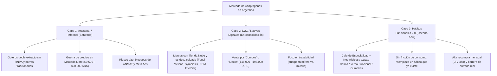

# Investigación de Mercado Exhaustiva: Adaptógenos, Hongos Funcionales y Oportunidades de Marca Propia (D2C) en Argentina

> [!IMPORTANT]
> **Veredicto Ejecutivo en 30 segundos:**
> Tu intuición es **100% acertada**. Entrar hoy a vender **gotas (extractos líquidos), cápsulas genéricas o polvos puros** de Melena de León, Reishi o Cordyceps con una estética "verde/marrón artesanal" es entrar a una **guerra de precios (Océano Rojo)** plagada de productores informales en Mercado Libre y Meta Ads.
> Sin embargo, **el nicho NO está muerto: está pasando de la "Fase 1 (Suplemento crudo)" a la "Fase 2 (Hábito y Alimento Funcional)"**. La verdadera mina de oro para crear una **marca poderosa** está en los **vehículos de consumo diario** (Café de especialidad con adaptógenos, Cacao ritual nocturno, Blends de Yerba Mate funcional o Gomitas sin azúcar) y en una estética que rompa con el cliché "hippie/botánico" para ir hacia el **alto rendimiento, diseño minimalista moderno o lifestyle urbano**.

---

## 1. Radiografía del Mercado Argentino Actual (2026)

El mercado de hongos funcionales (*Melena de León, Cordyceps, Reishi, Chaga, Tremella*) y raíces adaptógenas (*Ashwagandha, Rhodiola, Maca Negra*) explotó en Argentina entre 2023 y 2026. Hoy conviven **tres capas muy distintas de competidores**:

### ¿Por qué ves tantos anuncios de "Mayoristas" y precios regalados en Mercado Libre?
1. **Baja barrera de entrada en "Gotas" y "Polvos":** Muchos emprendedores compran tinturas madre a granel o polvo importado (a menudo *micelio cultivado en arroz*, que tiene muy pocos principios activos reales en comparación con el *cuerpo fructífero* 100% puro), compran frascos goteros de vidrio ámbar en una droguería, imprimen una etiqueta verde/marrón y salen a vender en Meta Ads o Mercado Libre.
2. **El problema de los anuncios mayoristas que viste en Meta:** Muchos de esos proveedores mayoristas (como *REM, InterSer, Funginista, Royal Fungi* o fraccionadores más chicos) buscan que vos revendas su marca o te venden goteros sin marca. Si les comprás el mismo gotero o cápsula que le venden a otros 200 emprendedores, **tu único diferencial es cuánto pagás el clic en Meta Ads**. Eso no construye una marca poderosa.

---

## 2. Mapa de Precios y Competencia por Formato en Argentina

Analizamos los precios reales actuales en **Mercado Libre Argentina** y tiendas **D2C (Tienda Nube)** para entender dónde hay margen y dónde hay saturación:

| Formato | Nivel de Competencia | Rango de Precios (ARS) | Jugadores Referentes | Diagnóstico para entrar hoy |
| :--- | :---: | :---: | :--- | :--- |
| **Gotas / Doble Extracto (50-100ml)** | 🔴 **Extrema (Saturado)** | \$15.000 – \$25.000 (unidad) \$49.000 – \$96.000 (Pack x3/x5) | *Symbiosis Fungi, REM, InterSer, Futuro Fungi + cientos de artesanales* | **No recomendado.** El cliente desconfía del sabor alcohólico, olvida tomar las gotas y compara por mililitro en MeLi. |
| **Polvo Puro (50g - 100g)** | 🔴 **Alta (Commoditizado)** | \$9.500 – \$40.000 | *New Garden, fraccionadores en MeLi* | **No recomendado.** Se percibe como un ingrediente de dietética, difícil de diferenciar y con sabor terroso. |
| **Cápsulas (30 - 60 un.)** | 🟠 **Media-Alta** | \$25.000 – \$48.000 | *Fungi Melena, ENA Sport, Geonat (Fungileon), Espora Sur, Natier* | **Difícil para empezar de cero.** Ya entraron laboratorios grandes (*ENA, Geonat, Natier*) que tienen escala en farmacias y dietéticas. |
| **Café con Adaptógenos (*Mushroom Coffee*)** | 🟢 **Baja-Media (En despegue)** | \$24.990 – \$48.990 (nacional) \$55.000 – \$90.000 (importado MeLi) | *Café Futuro (Futuro Fungi), Smart Coffee, Queen Energía, MushGoom* | **Gran oportunidad.** En MeLi casi todo lo que aparece es importado caro ("compra internacional" de EE.UU. que tarda semanas). Hay pocas marcas locales fuertes. |
| **Cacao Funcional / Chai Latte Adaptógeno** | 🟢 **Muy Baja (Océano Azul)** | \$28.000 – \$52.000 | *Be Powder, pequeños lotes de nicho* | **Excelente oportunidad.** Posicionado para la tarde/noche ("el reemplazo del vino o del café de la tarde para bajar el cortisol"). |
| **Gomitas Funcionales (*Gummies*)** | 🟢 **Baja (Alta barrera técnica)** | \$45.000 – \$50.000 (frasco) \$70.000 – \$98.000 (packs) | *MushGoom, importados de EE.UU.* | **Muy atractivo para Meta Ads.** Visualmente viral (UGC/TikTok), cero fricción de sabor, pero requiere un laboratorio de fasón con línea de pectina. |
| **Yerba Mate Funcional (Nootrópica / Calma)** | 🟢 **Baja (Fuerte encaje cultural)** | \$8.000 – \$18.000 (paquete premium / lata) | *Mate Futuro, blends de autor en Misiones* | **Oportunidad de volumen y recurrencia**, ideal si se vende en lata coleccionable o kit degustación de 3 estados (Focus, Energy, Calm). |

---

## 3. El "Secreto Sucio" del Nicho: ANMAT, Regulación y Riesgo de Cuenta

> [!CAUTION]
> **El factor que el 90% de los principiantes ignora y les cuesta el negocio:**
> La **ANMAT (a través del INAL)** ha emitido decenas de disposiciones prohibiendo la venta de adaptógenos (especialmente mezclas de *Reishi, Melena de León y Ashwagandha*) de marcas de Instagram y Mercado Libre que **no cuentan con RNE (Registro Nacional de Establecimiento) ni RNPA (Registro Nacional de Producto Alimenticio) verificables en SIFeGA**.

### ¿Por qué esto es una ventaja competitiva brutal para vos si hacés las cosas bien?
1. **Filtro natural de competidores:** La mayoría de los anuncios baratos que ves en Meta son de productores caseros o semi-artesanales sin RNPA real. Cuando crecen un poco, ANMAT los intima o Mercado Libre les da de baja las publicaciones.
2. **El truco regulatorio del "Alimento / Infusión" vs. "Suplemento Dietario":**
   - Registrar un **Suplemento Dietario** (Art. 1381 del Código Alimentario Argentino) en cápsulas o gotas con nuevos extractos lleva más tiempo y tiene restricciones estrictas en la etiqueta.
   - En cambio, desarrollar un **Café Tostado Molido / Soluble o un Cacao en Polvo con extractos de hongos comestibles aprobados en el CAA** a través de un laboratorio o planta elaboradora que ya tenga RNE/RNPA activo es mucho más limpio publicitariamente y en Meta Ads (porque Meta suele rechazar anuncios de "pastillas y gotas medicinales", pero **no bloquea anuncios de café, cacao o bebidas funcionales**).

---

## 4. Análisis Profundo de tu Idea: ¿Por qué el Café con Adaptógenos (y Bebidas Rituales) gana por goleada?

Mencionaste dos cosas clave en tu mensaje:
1. *"He visto que los adaptógenos se pueden vender en otros formatos, como por ejemplo el café, ese yo creo que podría ser menos competencia y quizás más nuevo"*.
2. *"Tengo una idea, un estilo que podría darle, muy natural, verde con marrón o cosas así"*.

Vamos a analizar ambas con bisturí comercial:

### A. Por qué el formato "Café / Bebida Ritual" supera 10 a 1 a las Gotas y Cápsulas
En e-commerce D2C (Direct-to-Consumer), el problema número uno de los suplementos en gotas o pastillas es la **"fatiga de suplementación"**: la gente compra el gotero por impulso en un anuncio de Instagram, lo toma 5 días, se olvida porque le da fiaca contar 30 gotas en medio vaso de agua, y **nunca vuelve a comprar**. Sin recompra (*LTV - Lifetime Value*), el costo de publicidad en Meta Ads (CPA) te come toda la rentabilidad.

En cambio, **el argentino YA toma café o mate todas las mañanas sin olvidarse ni un solo día**.
- **Propuesta de valor imbatible:** *"El café te da energía pero te deja ansioso, con taquicardia o acidez a media mañana. Nuestro café de especialidad con Melena de León + Cordyceps (+ L-Teanina) te da el doble de foco mental durante 6 horas, cero ansiedad y sin bajón a la tarde"*.
- **Cero cambio de hábito:** El cliente no tiene que "acordarse de tomar un remedio". Simplemente cambia la bolsa de café que compra en el supermercado por tu marca.
- **Recompra relojito cada 25-30 días:** Una bolsa de 250g dura exactamente entre 20 y 25 días tomando una taza diaria. Eso te permite armar un modelo de **suscripción o recompra por WhatsApp / Email Marketing** donde a partir del segundo mes tu costo publicitario es **\$0**.

### B. ¡Cuidado con la estética "Verde con Marrón Natural"! (Cómo diferenciarte de verdad)
Acá va un consejo estratégico honesto: **el 95% de las marcas de adaptógenos en Argentina usan verde musgo, marrón tierra, papel madera (kraft) y dibujitos de hongos del bosque**.
- Si hacés un packaging verde y marrón con estética "botánica/forestal", cuando el usuario haga scroll en Instagram **va a pensar que sos uno más de los 50 anuncios de goteros que vio esa semana**.
- Las marcas de *mushroom coffee* y adaptógenos que facturan decenas de millones de dólares en EE.UU. y Europa (*Everyday Dose, Ryze, Four Sigmatic, MUD\WTR, Dirtea, Spacegoods*) **escaparon del look "dietética/herboristería"** y se fueron hacia:
  1. **Estética "Clean Tech / Productividad / Biohacking Minimalista":** Blanco hueso, crema, tipografía suiza audaz en negro mate, toques de naranja quemado o azul cobalto. Apunta a programadores, emprendedores, arquitectos, estudiantes, profesionales de 25 a 45 años que quieren **rendir más en el trabajo sin quemarse la cabeza**.
  2. **Estética "Cafetería de Especialidad Contemporánea":** Latas coleccionables o bolsas doy-pack mate con acabado *soft-touch* (que da placer tocar), donde el protagonista es el ritual gastronómico y el foco mental, no "el hongo medicinal".

---

## 5. Tres Conceptos de "Producto Estrella" para Crear una Marca Poderosa

Si tu objetivo es crear una **marca poderosa** (y no simplemente revender un producto genérico de China), estas son las **3 mejores arquitecturas de negocio** hoy en Argentina:

### Opción 1 (La más recomendada): "El Sistema de Energía y Calma de 24 Horas" (Café + Cacao Adaptógeno)
En lugar de vender un producto aislado de \$25.000 ARS (donde el envío te mata el margen y el CPA de Meta no cierra), creás un **Ritual de Día y de Noche**:
- **Producto AM (Foco y Energía sin ansiedad):** Blend de Café de Especialidad (molido o liofilizado soluble premium) + Extracto doble en polvo de **Melena de León + Cordyceps**.
- **Producto PM (Desconexión y Sueño Profundo):** Blend de Cacao Alcalino Puro + Canela Ceylán + **Reishi + Ashwagandha (o Magnesio)**. Un "chocolate caliente nocturno sin azúcar" para apagar la mente después de trabajar y dormir profundo.
- **Por qué es ganador:**
  - Podés vender el **"Kit Ciclo Completo (AM + PM)"** a un ticket promedio (AOV) de **\$55.000 a \$68.000 ARS**, lo que te da margen de sobra para pagar publicidad en Meta Ads y ofrecer envío gratis.
  - Visualmente en anuncios de video (Reels/TikTok) es hipnótico: preparar un café espumoso a la mañana o un cacao caliente a la noche vende muchísimo más que mostrar un frasco de pastillas.

### Opción 2: Café Funcional Soluble en "Starter Kit" con Espumador de Regalo
Es el modelo que hizo multimillonarias a marcas como *Everyday Dose* y *Ryze* en EE.UU. y que en Argentina casi nadie aplica bien:
- El problema del café molido de filtro es que mucha gente en su casa solo usa batidor/instantáneo o cápsulas y no tiene prensa francesa.
- Si hacés un **Blend Soluble Liofilizado Premium** (café colombiano liofilizado + extracto de Melena de León y Cordyceps soluble en agua) y lo vendés en un **"Kit de Inicio"** que incluye:
  1. Lata o Doypack de 30 porciones.
  2. Un **espumador eléctrico de leche (frother)** minimalista con tu logo grabado (ese sí lo podés importar o comprar al por mayor por monedas).
  3. Una cuchara medidora metálica (*scoop*).
- **Efecto psicológico:** El cliente siente que está recibiendo un "kit de experiencia" tangible y valioso (acá combinás lo mejor del producto físico de China —el espumador y el scoop— con un consumible nacional de recompra mensual).

### Opción 3: Nicho Alternativo si decidís NO entrar en Adaptógenos -> Hidratación Celular y Electrolitos "Clean" (Estilo *LMNT* / *Liquid I.V.*)
Si después de evaluar los adaptógenos sentís que preferís otra tendencia global que recién está naciendo en Argentina:
- En EE.UU. y Europa, el boom más grande de e-commerce D2C de los últimos 24 meses son los **sobres (sticks) de Electrolitos sin azúcar para foco matutino, ayuno intermitente, entrenamiento y resaca** (marcas como *LMNT*, *Waterdrop* o *Humantra*).
- En Argentina, el mercado de electrolitos sigue dominado por bebidas llenas de azúcar (Gatorade/Powerade) o polvos deportivos de gimnasio con estética de fisicoculturismo (*Star Nutrition*).
- **La oportunidad:** Una marca de hidratación diaria en sticks (Sodio + Potasio + Citrato de Magnesio + sabores naturales como Pomelo Rosado o Lima-Sal Marina) apuntada a gente que hace running, pádel, crossfit, ayuno intermitente o trabaja muchas horas en la oficina. Ticket alto en cajas de 30 sobres, peso de envío ínfimo y recompra mensual garantizada.

---

## 6. Números Reales: Unit Economics Estimados en Argentina (Modelo D2C)

Para que una marca de e-commerce sea rentable en Argentina pautando en Meta Ads, tu estructura de costos para un **Kit o Producto Estrella** debería verse así:

| Concepto | Producto Individual (1 Bolsa Café Funcional 250g) | Kit Estrella (Pack AM Café + PM Cacao o Pack x2) |
| :--- | :---: | :---: |
| **Precio de Venta al Público (PVP)** | \$28.000 ARS | **\$54.000 ARS** |
| **Costo de Producto (COGS - Fasón + Packaging)** | -\$7.500 ARS (27%) | **-\$14.000 ARS (26%)** |
| **Comisión Pasarela de Pago + Tienda Nube (~6%)** | -\$1.680 ARS | **-\$3.240 ARS** |
| **Costo de Envío (absorbido o subsidiado)** | Pagado por el cliente | **-\$5.500 ARS (Envío Gratis incluido)** |
| **Margen Bruto antes de Publicidad** | \$18.820 ARS (67%) | **\$31.260 ARS (58%)** |
| **CPA Objetivo en Meta Ads (Costo por Compra)** | -\$10.000 a -\$12.000 ARS | **-\$12.000 a -\$15.000 ARS** |
| **Ganancia Neta en la 1ra Compra** | \$6.820 – \$8.820 ARS | **\$16.260 – \$19.260 ARS (30% - 35% Neto)** |
| **Ganancia Neta en la 2da Compra (Recompra sin Ads)** | **\$18.820 ARS (67% Neto)** | **\$31.260 ARS (58% Neto)** |

> [!TIP]
> **La lección clave de esta tabla:** En e-commerce de consumibles, la primera venta paga el costo de adquirir al cliente (y te deja un 25-35% limpio si vendés en **packs/kits**), pero la verdadera fortuna se hace en el **mes 2, 3 y 4** cuando ese cliente te vuelve a comprar por WhatsApp o email sin que le tengas que pagar un centavo a Mark Zuckerberg. Eso es imposible vendiendo un producto genérico de China que la gente compra una sola vez en la vida.

---

## 7. Cómo Fabricarlo en Argentina (Proveedores y Modelos de Entrada)

Tenés **3 caminos** según el capital inicial que quieras invertir:

1. **Camino A: Validación Rápida (Bajo Capital – Co-branding o Mayorista Personalizado)**
   - Hablar con productores nacionales que ya tienen **RNE/RNPA** y producen extractos o blends (ej. *REM Argentina, Funga, Provefarma, Calihepat+, Biodyx, Nutrivita* o tostadores de café de especialidad que hacen maquila para terceros).
   - Comprar un lote chico (MOQ de 50 a 100 unidades) bajo modalidad de etiqueta privada o fasón semi-estándar para **validar los anuncios en Meta Ads y medir el CPA real** sin inmovilizar millones de pesos.
2. **Camino B: Desarrollo a Fasón Propio (Capital Medio – Marca 100% Propia)**
   - Contratar un laboratorio de suplementos/alimentos funcionales habilitado por ANMAT (como *Laboratorio Biodyx, Formulab, Calihepat+, Nutrivita* o un tostador de café con RNE habilitado que incorpore el extracto seco con certificado de análisis).
   - Diseñar un *packaging* superior (latas o bolsas doy-pack impresas + caja de unboxing con guía de rituales).
3. **Camino C: Híbrido (El "Starter Kit")**
   - Tercerizar el consumible (café/cacao con adaptógenos) localmente con RNPA y combinarlo con accesorios de marca propia (espumador, vaso térmico de diseño, cuchara medidora) para inflar el valor percibido desde el día 1.

---

## 8. Hoja de Ruta Sugerida para Avanzar

1. **Definir el Vehículo y el Ángulo:** ¿Te entusiasma más el ángulo **"Café + Cacao Ritual (Foco de día / Calma de noche)"**, el **"Starter Kit de Café Funcional Soluble"** o explorar el nicho de **"Hidratación/Electrolitos Clean"**?
2. **Contactar a los Proveedores con las Preguntas Correctas:** Puedo armarte el **guion exacto de preguntas técnicas** para enviarles a los mayoristas que viste en Meta y a los laboratorios de fasón (para filtrar en 2 minutos quién es un improvisado sin papeles y quién tiene RNE/RNPA, cuerpo fructífero real y buenos márgenes).
3. **Diseñar la Identidad y Oferta Irresistible:** Definir nombre, paleta visual (saliendo del cliché verde/marrón saturado), estructura de packs para elevar el ticket promedio y ángulos de anuncios para Meta Ads.
